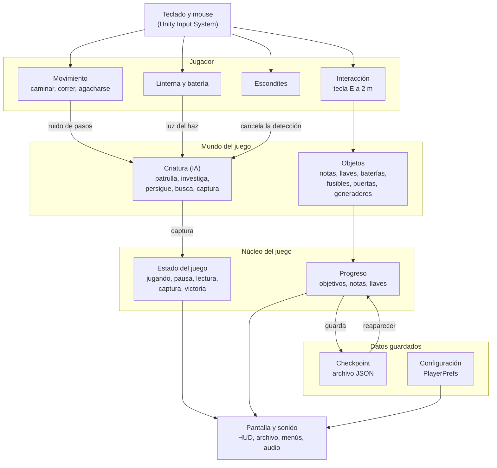

# Arquitectura Técnica

## Descripción de la sección

Explica cómo está construido técnicamente el videojuego y cómo se comunican sus componentes.

## Arquitectura

Dark Mutant está construido en Unity 6 con scripts en C#, organizados en seis carpetas según su función: `Player`, `Creature`, `Interaction`, `Core`, `UI` y `Audio`. El siguiente diagrama muestra cómo se conectan las partes del juego: las entradas del jugador controlan sus acciones; esas acciones afectan a la criatura y a los objetos; el núcleo registra el progreso y el estado de la partida, y todo se refleja en la pantalla.

## Escenas

El juego final utiliza dos escenas. El bosque, las tres cabañas, los generadores y el laboratorio están en una sola escena para evitar pantallas de carga durante la partida.

| Escena | Contenido | ¿Se incluye en la versión final? |
|---|---|---|
| `MainMenu` | Menú principal: nueva partida, continuar, configuración y créditos. | Sí |
| `Mundo` | Escena jugable completa: bosque, cabañas, generadores, laboratorio, jugador, criatura y pantalla de victoria. | Sí |
| `MecanicasTesting` | Escena de pruebas para validar mecánicas antes de pasarlas a `Mundo`. | No |

## Componentes principales

| Componente | Responsabilidad | Dependencias |
|---|---|---|
| `PlayerInputController` | Lee las acciones del Input System (mover, mirar, correr, agacharse, interactuar, linterna, pausa y archivo) y las entrega a los demás scripts del jugador. | `PlayerInputActions` |
| `PlayerMotor` | Movimiento en primera persona con Character Controller: caminar, correr, agacharse, gravedad y ruido de pasos. | `PlayerInputController`, `NoiseEmitter`, `WeatherController` |
| `PlayerInteractor` | Lanza un raycast de 2 m desde la cámara, muestra el aviso del objeto y ejecuta la interacción con E. | `Interactable`, `GameEvents`, `GameStateManager` |
| `PlayerHiding` | Entra y sale de escondites; bloquea el movimiento y la linterna mientras el jugador está escondido. | `HidingSpot`, `PlayerMotor` |
| `Flashlight` + `BatteryModel` | Enciende y apaga la linterna, descuenta 0.3 % de batería por segundo y aplica las recargas de 40 %. | `PlayerHiding`, `GameEvents` |
| `Interactable` (clase base) | Define el comportamiento común de todo objeto con el que se interactúa. De ella heredan `DoorInteractable`, `KeyPickup`, `NotePickup`, `BatteryPickup`, `GeneratorInteractable` y `HidingSpot`. | `PlayerRig`, `GameProgress` |
| `CreatureAI` | Máquina de estados de la criatura: patrulla, investigación, persecución, búsqueda y captura. Percibe al jugador por la vista, el ruido y la linterna. | `NavMeshAgent`, `NoiseEmitter`, `PlayerHiding`, `Flashlight`, `ProtectedZone`, `GameStateManager` |
| `ProgressionDirector` | Cambia el objetivo en pantalla al completar cada etapa y guarda una bandera permanente para no retroceder. | `GameProgress`, `GeneratorInteractable`, `GameEvents` |
| `GameStateManager` | Controla el estado global: `Playing`, `Paused`, `Reading`, `Captured` y `Victory`. Pausa el juego al perder el foco de la ventana. | `PlayerInputActions` |
| `GameProgress` (estático) | Guarda en memoria el progreso de la partida: objetivo actual, banderas, notas y llaves obtenidas. | — |
| `NoiseEmitter` (estático) | Emite eventos de ruido con posición y radio; calcula el radio de los pasos según la postura y la lluvia. | `WeatherShelterZone` |
| `GameEvents` (estático) | Canal de mensajes hacia la interfaz: avisos, textos de interacción, lectura de notas y subtítulos. | — |
| `CheckpointManager` | Guarda el estado en cada checkpoint y, tras una captura, restaura al jugador, la criatura y la batería (mínimo 30 %). | `SaveSystem`, `GameProgress`, `CreatureAI`, `Flashlight`, `GameFlow` |
| `SaveSystem` (estático) | Escribe y lee la partida guardada en un archivo JSON con copia de respaldo. | `GameProgress` |
| `GameSettings` (estático) | Guarda la configuración del jugador (volumen, sensibilidad, subtítulos, calidad) en PlayerPrefs. | — |
| `WeatherController` | Controla la lluvia y su audio; informa a los demás sistemas si el jugador está bajo la lluvia. | `GameProgress`, `GameSettings`, `PlayerRig` |
| `HUDController`, `NotesUI`, `BatteryBarHUD` y pantallas | Muestran el objetivo, la batería, el archivo de notas y llaves, la pausa, la captura y la victoria. | `GameProgress`, `GameStateManager`, `GameEvents` |

## Comunicación

Los sistemas se comunican principalmente mediante **eventos de C#** (`event Action`), para que quien produce un cambio no necesite conocer a quien lo muestra o reacciona a él:

- **Ruido:** `PlayerMotor` y `GeneratorInteractable` llaman a `NoiseEmitter.Emit(posición, radio, tipo)`. `CreatureAI` está suscrita al evento `NoiseEmitted` y decide si investiga.
- **Progreso:** cuando el jugador recoge una nota o una llave, `GameProgress` dispara `NoteAdded`, `KeyAdded` o `ObjectiveChanged`. El HUD y el archivo de notas se actualizan solos.
- **Mensajes en pantalla:** cualquier script llama a `GameEvents.ShowMessage()`, `SetPrompt()` o `ShowReader()`, y la interfaz se encarga de mostrarlo.
- **Estado del juego:** `GameStateManager` informa los cambios de estado (pausa, lectura, captura y victoria). La interfaz abre la pantalla que corresponde y los scripts del jugador dejan de recibir entradas.
- **Referencias directas:** solo se usan entre componentes del mismo objeto o cuando la relación es fija, por ejemplo la criatura con el jugador (`PlayerRig`) o una puerta con su generador.

El progreso se identifica con **banderas de texto** (`pickup:<id>`, `door.unlocked:<id>`, `door.open:<id>`). Así una puerta abierta o una llave recogida se recuerdan al reaparecer en un checkpoint.

## Principios técnicos

- Bajo acoplamiento cuando sea razonable: los sistemas se avisan mediante eventos en lugar de buscarse entre sí.
- Responsabilidades claras: un script por mecánica (movimiento, linterna, escondite, interacción).
- Código mantenible: los valores ajustables (velocidades, radios, tiempos) se exponen en el Inspector con `[SerializeField]` en lugar de escribirse fijos en el código.
- Datos separados de lógica cuando corresponda: el progreso vive en `GameProgress` y se guarda con `SaveSystem`, separado de los objetos de la escena.
- Evitar dependencias innecesarias: solo se usan paquetes oficiales de Unity.

> **Navegación:** [[00 - Índice]] · ← [[04 - Guardado y Configuración]] · ← [[02 - Motor y Herramientas]]